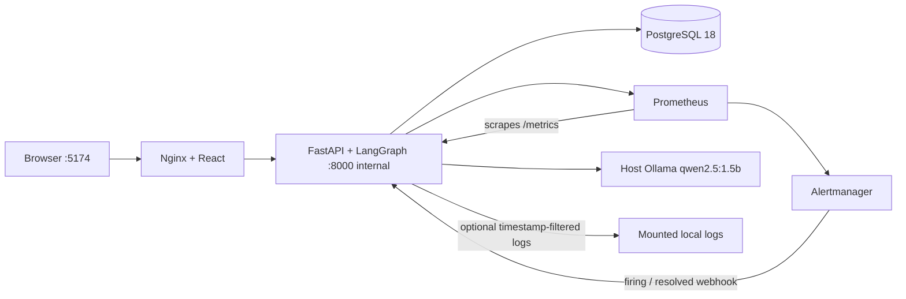

# AIOps Incident Response Agent — Architecture

## Runtime

## Service boundaries

- `dashboard` — Nginx serves React production build, proxies `/api/` to `backend:8000`.
- `backend` — FastAPI endpoints, incidents, LangGraph investigation, structured logs, Prometheus metrics.
- `postgres` — Persistent `incidents` table. Database managed by **new** `aiops-final-postgres-data` external volume.
- `prometheus` — Scrapes `backend:8000/metrics`, evaluates alerts. New TSDB storage starts empty.
- `alertmanager` — Routes firing and resolved alerts to `http://backend:8000/api/alerts/webhook`.
- `ollama` — Installed outside Compose on the WSL host. Only local host-network access is intended.

## Evidence-based investigation

The new `/api/incidents/{uuid}/investigate-verified` uses a separate LangGraph flow:
1. Read actual incident metadata from PostgreSQL.
2. Query Prometheus samples in a bounded time range around the incident's `created_at` timestamp.
3. Filter only logs with parseable, timezone-aware timestamps in that range.
4. If there is no time-aligned evidence, skip model inference and report missing evidence.
5. Otherwise ask Ollama for conditional hypotheses, clearly distinct from facts.

Historical Prometheus data will be unavailable immediately after migrating to a NEW Prometheus TSDB.
The old TSDB (if persisted) and old containers remain unchanged, but are not part of the new Compose service.
This project does NOT validate actual causal root causes automatically or auto-remediate incidents.

## Local ports

| Service | Host | Internal |
| --- | --- | --- |
| Dashboard | 127.0.0.1:5174 | dashboard:80 |
| FastAPI | 127.0.0.1:8001 | backend:8000 |
| PostgreSQL | 127.0.0.1:15432 | postgres:5432 |
| Prometheus | 127.0.0.1:9090 | prometheus:9090 |
| Alertmanager | 127.0.0.1:9093 | alertmanager:9093 |
